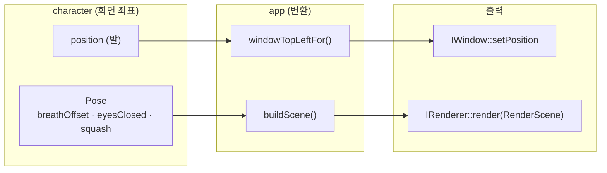

# app 모듈 상세 설계

| 항목 | 내용 |
|---|---|
| CMake 타깃 | `deskpet_app` (STATIC, 플랫폼 독립), `TinyDeskPet` (WIN32 실행 파일) |
| 네임스페이스 | `deskpet::app` |
| 의존 | `deskpet_character`, `deskpet_platform_api`, `deskpet_renderer_api` (+ 실행 파일은 Win32/D3D11 구현) |
| 관련 요구사항 | FR-05, FR-13, FR-14, FR-15, FR-30, FR-31 |

## 1. 책임

모든 모듈을 **연결**하고 메인 루프를 돌립니다.

- 하는 일: 초기화 순서 관리, 이벤트 분배, 고정 시간 간격 업데이트, 캐릭터 위치 → 창 위치 변환, 캐릭터 포즈 → `RenderScene` 변환, 메뉴 구성과 명령 처리, 종료 코드 결정
- 하지 않는 일: OS·그래픽 API 직접 호출. 구체 클래스 생성 (→ `main_win32.cpp`)

## 2. 파일 구성

| 파일 | 역할 |
|---|---|
| `src/app/Application.h/.cpp` | 메인 루프 (플랫폼 독립, 테스트 대상) |
| `src/app/CameraFit.h/.cpp` | 모델 경계 상자를 창에 맞추는 카메라 (§4.7) |
| `src/app/main_win32.cpp` | Windows 진입점 (`wWinMain`): 설정·로그 준비, 구체 객체 조립 |
| `src/app/win32/TinyDeskPet.manifest` | DPI 인식(PerMonitorV2), UTF-8 코드 페이지, 지원 OS 선언 |
| `cmake/TinyDeskPet.rc.in` | 실행 파일 버전 정보 리소스 템플릿 |

## 3. 공개 인터페이스

```cpp
namespace deskpet::app {

enum class MenuCommand : std::uint8_t {
    /* 1, 2, 6~11: 예전 버전·점프·크기·모델 정보·모델 열기 */
    ResetPosition = 3, Quit = 4, ToggleVisible = 5, Settings = 12,
};

enum class ExitCode : std::uint8_t {
    Ok = 0, InitializationFailed = 1, RendererFailed = 2,
    UnhandledException = 3,   // main_win32.cpp 최상위 예외 처리
};

class Application {
public:
    Application(core::AppConfig config,
                std::unique_ptr<platform::IWindow> window,
                std::unique_ptr<renderer::IRenderer> renderer,
                core::TimeSource timeSource = core::makeSteadyTimeSource());
    ~Application();

    [[nodiscard]] int run();     // 초기화 → 루프 → 정리. 종료 코드 반환
    void requestQuit() noexcept;
    void setModel(std::shared_ptr<const model::Model> model);  // run() 전. 있으면 슬라임 대신 표시

    [[nodiscard]] const character::CharacterController& character() const noexcept;

    // 설정 창 (§4.10, ADR-0016)
    using ClipLoader = std::function<std::shared_ptr<const model::MotionClip>(
        anim::Motion, const std::string& configured, float loopStart)>;
    void setClipLoader(ClipLoader loader);
    using SettingsWriter = std::function<void(const std::vector<core::IniValue>&)>;
    void setSettingsWriter(SettingsWriter writer);
    void setUiFont(const std::filesystem::path& file);
    void setUiDarkTheme(bool dark);
    void openSettings();
    void applySettingsAction(const ui::SettingsAction& action);
};
}
```

## 4. 동작 명세

### 4.1 초기화 (`initialize`)

| 순서 | 동작 | 실패 시 |
|---|---|---|
| 1 | `window->create({title, size, position=(0,0), alwaysOnTop})` | `InitializationFailed` |
| 2 | `dpiScale = window->dpiScale()`. 1이 아니면 `창 크기 = 설정 × 배율`로 `setSize`, 카메라 재계산 (DEBT-01) | — |
| 3 | `renderer->initialize(window->nativeHandle(), 창 크기, options)` | `InitializationFailed` |
| 4 | `refreshBounds()` → 저장된 위치 복원(§4.8), 없거나 화면 밖이면 `resetCharacterPosition()` | — |
| 5 | `applyHitRegion()` — 슬라임 타원 / 모델 사각형(+외곽선 여유 3px) | — |
| 6 | `window->show()`, `showTrayIcon("TinyDeskPet")`(실패해도 계속), 시간 기준점 기록 | — |

### 4.2 메인 루프 (`tick`, 한 프레임)

```text
events.clear(); window.pollEvents(events)
for event in events: handleEvent(event)
if quitRequested: break
if hidden: window.waitForEvents(100ms); lastTime = now; continue   # 숨김: 갱신·렌더링 없음

now = timeSource(); delta = now - lastTime; lastTime = now
steps = timestep.advance(delta)
if character.state != Dragged: refreshGround()   # 걷기·던지기로 다른 모니터에 넘어갔을 수 있음
repeat steps: character.update(timestep.step())

syncWindowToCharacter()
updateAnimation()   # 캐릭터 Pose → anim::AnimationInput → 스킨 행렬·표정 (모델이 있을 때)
scene = buildScene()
if settings open: scene.ui = updateSettings(delta); scene.uiFrame += 1   # §4.10
result = renderer.render(scene)
if result == Skipped: window.waitForEvents(16ms)  # Present 생략 → VSync 대기 없음 (DEBT-02)
if result == Fatal: exitCode = RendererFailed; break
```

### 4.3 이벤트 처리

| 이벤트 | 처리 |
|---|---|
| `PointerDownEvent{Left}` | "항상 위"가 꺼져 있으면 먼저 `window.bringToFront()` (창은 클릭해도 활성화되지 않아 Windows가 앞으로 올려 주지 않음). 설정 창이 마우스를 원하면(`wantsMouse`) 설정 창으로 누름 + `uiPointer_`. 아니면 `character.onPointerDown(screen)` |
| `PointerMoveEvent` | `uiPointer_`가 아니면 `character.onPointerMove(screen)` |
| `PointerUpEvent{Left}` | `uiPointer_`면 설정 창으로 뗌. 아니면 `refreshGround()` 후 `character.onPointerUp(screen)` — 다른 모니터에 놓았을 때 그 모니터의 바닥 사용 |
| `PointerUpEvent{Right}` | 설정 창 위가 아니면 `onContextMenu(screen)` |
| `DoubleClickEvent{Left}` | 설정 창 위면 누름으로 넘김(두 번째 클릭이 이 메시지로 옴). 아니면 `onDoubleClick()`: 모델과 상호작용 클립(`clips_[Interact]`, 길이 > 0)이 있으면 `character.interact(클립 길이)`, 없으면 `character.jump()` (기본 동작). 애니메이션 입력 `motionSerial` = `pose.actionSerial` (다시 더블클릭하면 처음부터) |
| `MouseWheelEvent` | 설정 창으로 (열려 있을 때만 쓰임) |
| `WorkAreaChangedEvent` | `refreshGround()`, `refreshBounds()` — 이후 `update`가 낙하/보정 처리 |
| `QuitRequestedEvent` | `requestQuit()` |
| `TrayMenuRequestedEvent` | `onContextMenu(screen)` — 캐릭터 우클릭과 같은 메뉴 (FR-18) |
| `DpiChangedEvent` | 창 크기 = 설정 × 배율 → `setSize`, `renderer.resize`, 카메라·경계·히트 영역 재계산, 발 위치 기준으로 창 재배치 |

### 4.4 컨텍스트 메뉴

| id | 라벨 | 활성 조건 | 동작 |
|---|---|---|---|
| `Settings` | 설정… | 항상 | `openSettings()` (§4.10) |
| `ResetPosition` | 위치 초기화 | 항상 | `resetCharacterPosition()` |
| `ToggleVisible` | 숨기기 / 보이기 | 항상 | `window.hide()/show()`. 숨김 중에는 트레이 메뉴로만 되돌릴 수 있음 |
| — | 구분선 | | |
| `Quit` | 종료 | 항상 | `requestQuit()` |

메뉴에는 자주 쓰거나 급할 때(캐릭터가 화면 밖에 걸림, 숨김) 필요한 것만 둡니다. 버전·모델 정보(FR-23)·모델 열기·크기(FR-06)는 설정 창으로 옮겼습니다(§4.10, ADR-0016). 점프는 더블클릭으로만(FR-13). 뺀 항목의 id(1, 2, 6~11)는 비워 둡니다.

**크기 조절 (FR-06)**: 10% ~ 200%, 10% 단위. 바뀌면 `resizeWindow()`가 DPI 변경과 같은 경로로 창·렌더러·카메라·벽·클릭 영역을 갱신하고, 발 위치를 기준으로 창을 다시 놓아 캐릭터가 같은 자리에 서 있습니다. 종료할 때 `[state] scale`로 저장하고, 시작할 때 10% 단위·범위로 맞춰 복원합니다.

**모델 읽기 (작업 스레드, `loadModelAsync`)**: `setModelLoader`로 받은 로더(main: 파일 읽기 + 텍스처 CPU 준비)를 `std::async`로 실행하고, 같은 스레드에서 같은 클립으로 자세 경계 상자(`displayBounds`, 정점 CPU 스키닝)까지 계산합니다. 매 프레임 `applyLoadedModel`이 결과가 준비됐는지(`wait_for(0)`)만 보고, 준비됐으면 모델·애니메이터·카메라·벽을 교체합니다. 실패(nullptr)면 지금 모델 유지. 첫 모델을 읽는 동안은 슬라임도 그리지 않음 (잠깐 보였다가 바뀌지 않게). 새 요청은 앞선 작업이 끝나길 기다린 뒤 시작하고(마지막 요청만 반영), 소멸자도 작업을 기다립니다. 성공한 경로는 `modelPath()` → main이 종료할 때 설정과 다르면 `[model] path`에 저장. Release 측정(VRM 0.x 모델, 정점 19.6만, 텍스처 11): 창은 0.05초에 뜨고, 작업 스레드 0.9초 뒤 모델이 나타남. 렌더 스레드가 멈추는 시간(GPU 업로드)은 0.7초 → 4ms

**클릭 통과 (FR-04, `updateClickThrough`)**: 매 프레임 렌더 뒤 `cursorPosition()`을 창 내부 좌표로 바꿔, 창 밖이면 통과. 창 안이면 `renderer->sampleAlpha(local)`의 알파가 0.1보다 크면(외곽선·안티에일리어싱 가장자리 포함) 클릭을 받고 아니면 통과. 왼쪽 버튼을 누르고 있는 동안(끌기)과 설정 창이 마우스를 원하는 동안(창 위, 창 위젯을 누르는 중)은 항상 받음. 알파는 2~3프레임 늦게 오지만 커서가 캐릭터에 닿자마자 누르는 경우가 아니면 차이가 없습니다.

**전체 화면 앱 자동 숨김 (`updateFullscreenHiding`)**: 0.5초마다(`lastTime_` 기준) `window->fullscreenAppActive(발 위치)`를 확인해, 전체 화면 앱이 있으면 창을 숨기고 갱신·렌더링을 멈춤(`autoHidden_`). 닫히면 다시 보임. 사용자가 메뉴로 숨긴 상태(`hidden_`)와 따로 관리해서, 자동 숨김이 풀려도 사용자 숨김은 그대로.

### 4.5 좌표 변환

창(**오버레이**)은 발이 있는 모니터의 작업 영역 `O` 전체를 덮습니다 (ADR-0011). 캐릭터는 창 안의 **캐릭터 상자**(크기 `W × H`)로 움직이고, 발 위치를 `F`(화면 좌표)라 할 때

| 변환 | 공식 |
|---|---|
| 오버레이 | `O` = 몸 범위(`visibleRect`)의 왼쪽 아래·오른쪽 아래·위 가운데가 있는 모니터 작업 영역들을 합친 사각형 (보통 한 모니터, 경계에 걸치면 두 모니터). 바뀔 때만 창을 옮기고 렌더러 크기를 바꿈 (`updateOverlay`). 매 프레임 `SetWindowPos` 없음 |
| 발 → 상자 좌상단 (화면) | `(round(F.x − W/2), round(F.y − H))` = `characterRect()` |
| 상자 좌상단 (오버레이 내부) | 위 값 − `(O.left, O.top)` = `boxOffset()` |
| 모델 투영 | `rotationY(turn) × camera × boxToOverlay`. 카메라는 상자에 맞추고(§4.7), 투영 뒤 클립 좌표를 상자가 오버레이 안에서 차지하는 자리로 옮김: `x' = x·(W/Ow) + w·cx`, `y' = y·(H/Oh) + w·cy` (cx, cy = 상자 중심의 오버레이 NDC). 뷰포트를 상자로 줄이지 않으므로 상자 밖으로 나간 머리카락도 그려짐 |
| 3D 영역 (`sceneRegion`) | 지금 동작의 자세 범위(`motions[지금 동작]` 투영) ∪ 지금 본 위치(흔들리는 머리카락 포함)의 투영 범위 + 여유(상자 폭의 8%, 최소 8px), 오버레이 안으로 자름. 렌더러가 3D·MSAA를 이 크기로만 그림. 대기 중에는 상자 크기 정도 |
| 시작 위치 (발) | `(O.right − marginRight × 배율 − W/2, O.bottom)` |
| 발 x 범위 (FR-17) | `[desktop.left + (W/2 − wall.left), desktop.right − (wall.right − W/2)]` — **지금 동작의 그려지는 영역**(`wallRect`)이 가상 데스크톱 안에 머묾. 좌우는 `PoseBounds::screenX[지금 동작]`(실제 정점을 카메라로 투영, 작업 스레드에서 미리 계산), 슬라임은 몸 타원. 창 반폭으로 막으면 모델 바깥의 투명한 여백 때문에 화면 끝 앞에서 멈춰 보이므로, 창의 투명한 부분은 화면 밖으로 나가도 됨.<br>모든 동작 중 가장 넓은 폭(걸을 때 돌린 몸, 팔을 벌린 끌기 자세)으로 막으면 서 있을 때 그만큼 떠 보이고 그 차이가 모델마다 달라, 동작별로 막음. 동작이 바뀌면 `updateWalls`가 벽을 상자 폭 × 1.5/s로 옮기고(넓어지면 안쪽으로 미끄러져 들어옴), 벽에 붙어 있던 발은 벽이 바깥으로 옮겨도 붙어 있음(`setHorizontalBounds(…, keepAtWall)`, 넓은 끌기 자세로 막혔다가 놓으면 끝까지 따라감). 모델·크기·DPI·작업 영역이 바뀌면 `refreshBounds`가 바로 맞춤 |
| 상자 크기 `W × H` | 설정 크기 × DPI 배율 × 사용자 크기(%) (물리 px). 슬라임·모델 모두 상자에 맞춰 그리므로 상자 크기만 바꾸면 캐릭터 크기가 바뀜 (창은 그대로). 물리 상수(중력 등)는 배율과 무관 |
| 바닥 | `workAreaAt(F).bottom` |

플레이스홀더 캐릭터 (상자 내부 좌표, 그릴 때 `boxOffset`을 더함)

| 값 | 공식 |
|---|---|
| 기본 반지름 | `U = min(W, H)`일 때 `rx = 0.32 × U`, `ry = 0.27 × U` (세로로 긴 창에서도 비율 유지) |
| 착지 반동 반영 (슬라임만) | `ry' = ry × (1 − squash)`, `rx' = rx × (1 + 0.5 × squash)`. 모델은 늘이지 않고 anim이 관절로 웅크림 |
| 중심 | `(W/2, H − footMargin − ry' + breathOffset)`, `footMargin = 4px` |
| 보이는 영역 (`visibleRect`, 벽 계산) | 기본 타원을 숨쉬기 진폭 + 2px만큼 키운 사각형 |



모델이 있을 때 (ADR-0008)

| 값 | 공식 |
|---|---|
| 슬라임 | `placeholder.visible = false` |
| 애니메이션 (ADR-0010) | 상태 매핑 Idle/Walk/Dragged/Airborne → `anim::Motion`, `time`·`squash`·`blink`(= 눈 감음)·`idleMotion`(설정)을 넘겨 `ProceduralAnimator::evaluate`. 결과 스킨 행렬·표정 가중치를 `scene.character`에 복사 |
| 자세 경계 상자 (`PoseBounds`) | `standing`(서 있는 자세, 클립과 무관): 화면 크기·바닥. `all`(모든 동작 + 걸을 때 돌린 몸 = `displayBounds(50°)`): 벽·깊이 범위. `motions`(동작별): 3D 그리기 영역. 모델 읽기·클립 변경 때 작업 스레드에서 한 번에 잼 |
| 숨긴 슬라임 | 모델이 있으면 `placeholder`를 기본값으로 고정 — 숨쉬기 값이 바뀌면 장면 비교가 항상 "다름"이 되어 Present 생략이 안 됨 |
| 뷰×투영 | `rotationY(turn) × camera` (착지 반동으로 늘이지 않음). `turn`은 목표 `facing × 50°`로 **일정한 속도(50° / 0.2초)로 돌아감** (`core::moveTowards`, 즉시 바꾸면 튀어 보임. 방향을 바꾸면 정면을 지나 0.4초). 경계 상자는 `displayBounds(50°)`로 돌린 몸까지 포함. 걷는 방향으로 몸을 돌리되 얼굴이 보이도록 50°만 |
| 흔들림 관성 | `AnimationInput::movement` = (발 위치 변화 px × m/px)를 `rotationY(−turn)`으로 모델 축에 맞춘 값. y는 부호 반전(화면 아래 +). m/px는 `refitCamera`에서 발 평면의 (0,0,0)·(0,1,0)을 투영해 구함. 고정 스텝이 없던 프레임의 이동은 다음 프레임으로 넘김 |
| 커서 바라보기 (`lookTarget`, FR-28) | 직전 프레임 자세의 머리 위치를 화면에 투영 → 커서와의 차이(px)가 상자 높이 3배 안이면 (dx·m/px, −dy·m/px, 모델 키 × 0.6)을 `rotationY(−turn)`으로 모델 축에 맞춰 머리 위치에 더함 (커서는 화면 앞쪽에 있다고 봄). 밖이거나 숨김·`[animation] look_at = false`면 없음 |
| 보이는 영역 (`visibleRect`) | `all` 8개 꼭짓점을 화면에 투영한 사각형. 좌우·위는 상자 밖으로 나갈 수 있음(크기를 서 있는 자세로 맞추므로), 아래는 발까지. 벽 계산·설정 창 위치에 쓰고 클릭 판정에는 쓰지 않음 |

### 4.6 Windows 진입점 (`main_win32.cpp`)

1. 실행 파일 폴더를 구함 (`GetModuleFileNameW`)
2. `deskpet.ini` 로드 → 경고는 로그 준비 후 출력
3. 로그 레벨 설정, 싱크 = `OutputDebugStringW` + (설정 시) `deskpet.log`
4. 버전·Git 해시 로그
5. COM 초기화 (`CoInitializeEx`, WIC 텍스처 디코딩용. `Application`보다 오래 살도록 먼저 선언)
6. `Win32Window`, `D3D11Renderer` 생성 → `Application`에 주입
7. `[model] path`가 있으면 `loadModelFile` → 성공 시 `setModel`, 실패 시 경고 로그 후 슬라임 → `run()`
8. 종료 코드가 0이 아니면 메시지 박스로 로그 파일 위치 안내
9. 표준 예외는 최상위에서 잡아 로그 + 메시지 박스

빌드할 때마다 `config/deskpet.ini`와 `assets/models/`를 실행 파일 옆으로 복사합니다 (`deskpet_copy_runtime_files` 타깃. POST_BUILD는 재링크될 때만 실행되어 ini·모델만 바뀐 경우를 놓침).

진입점 추가 동작

| 동작 | 내용 |
|---|---|
| 단일 인스턴스 (FR-19) | 설정·로그보다 먼저 `CreateMutexW("Local\\TinyDeskPet.SingleInstance")`. `ERROR_ALREADY_EXISTS`면 조용히 0으로 종료 (두 번째 실행이 첫 실행의 로그를 밀어내지 않도록 로그보다 먼저) |
| 로그 | `core::LogFile` — 이전 실행 로그는 `deskpet.log.1`, 4MB 한도 |
| 마지막 위치 저장 | 종료 코드 0이면 `[state] last_x = 발 x, last_y = 바닥` 을 `deskpet.ini`에 기록 (`core::saveConfigValues`, 주석 유지). 공중에서 종료해도 높이는 바닥으로 |

### 4.7 카메라 맞춤 (`fitCameraToBounds`)

정면(+Z)에서 바라보는 원근 카메라. 화각 20°(망원이라 원근 왜곡이 적음), 위·옆 여백 2%, **아래 여백 0**.

`fitCameraToBounds(standing, 상자, all)`: 크기는 **서 있는 자세(`standing`)**로만 정하고, `all`(모든 동작)은 깊이 범위에만 씁니다. 기준은 **발 = 모델 원점(x = 0, z = 0)**, 바닥 높이 `g` = standing.min.y(서 있을 때의 **발바닥** — 발보다 낮은 꼬리·머리카락은 작업 표시줄 아래로 들어가 가려짐, [anim.md](anim.md) `standingBounds`)입니다. 이 평면에서 화면 반높이 `H`, 거리 `D = H / tan(10°)`, 앞으로 나온 깊이 `f = max(max.z, 0)`, 여백을 뺀 범위 `u = 0.98`, 가로 반폭 `w = max(−min.x, max.x)`.

1. 앞으로 f만큼 나온 점은 `D / (D − f)`배 커 보이므로, 축에서 a 떨어진 점이 들어오려면 `a ≤ u·(H − f·tan)`
2. `H = max((max.y − g + u·f·tan) / (1 + u), w ÷ (화면비·u) + f·tan)`
3. 시선 `(0, g + H, D)` → 발바닥(g)이 화면 맨 아래(창 바닥 = 작업 표시줄 위), 발(x = 0)이 화면 가로 가운데
4. near = max((D − all의 앞쪽 깊이) / 2, D / 10), far = 2·(D − min(all.min.z, 0)) — 앞으로 크게 나온 자세가 근평면에 잘리지 않게

- **가로 가운데를 발에 맞추는 이유**: 앱은 발 = 창 가로 중앙으로 보고 창 위치·벽을 계산합니다. 상자 중앙에 맞추면 한쪽으로 치우친 모델(비대칭 꼬리, 한 손 소품)이 밀려 그려져 화면 끝과 어긋납니다. 대신 넓은 쪽 반폭으로 좌우 대칭으로 맞춥니다.
- **아래 여백 0**: 여백이 있으면 발이 작업 표시줄에서 몇 px 떠 보입니다.
- **크기를 모든 동작이 아니라 서 있는 자세로**: 모든 동작을 담는 상자로 맞추면, 클립에 팔을 크게 벌리거나 뛰어오르는 순간이 하나만 있어도 상자가 커져 캐릭터가 작아지고, 클립을 바꿀 때마다 크기가 달라집니다. 서 있는 자세는 클립과 무관해 모델과 크기(%)만 크기를 정합니다. 상자 밖으로 뻗는 동작은 벽(`visibleRect` = `all`)과 3D 그리기 영역(`motions`)이 담아 화면 끝을 넘거나 잘리지 않습니다. 실행 중 동작마다 배율을 바꾸지는 않습니다(커졌다 작아져 어색함).
- **바닥을 상자 아래가 아니라 발바닥에**: 자세 경계 상자는 모든 동작을 담으므로, 대기 클립이 잠깐 웅크리는 순간 등이 있으면 상자 아래가 발바닥보다 낮습니다(예: 12cm). 상자 아래에 맞추면 평소 서 있을 때 그만큼 떠 보이고, 틈이 화면 크기에 비례해 200%에서는 100px을 넘습니다. 발바닥보다 낮은 자세는 화면 아래로 나가 작업 표시줄에 가려집니다 (3D 영역은 매 프레임 본 위치로 정하므로 잘리지 않음).
- 예전에는 상자 **앞면**(z = max.z)에 발을 맞췄습니다. 걷기 회전까지 담아 상자가 앞뒤로 깊어지자 z = 0의 실제 발이 원근 때문에 위로 떠 보였습니다. 상자 앞쪽 바닥 모서리는 실제 정점이 아니라 빈 구석이라 화면 아래로 나가도 됩니다.

### 4.8 마지막 위치 복원

1. `config.state.lastPosition()`이 없으면 기본 위치
2. 가상 데스크톱 밖(`x ∉ [left, right)`, `y ∉ (top, bottom]`)이면 기본 위치 (모니터 분리·해상도 변경 대비)
3. 그 위치로 `teleport` → 창을 옮김 → 그 모니터의 바닥으로 `refreshGround` → 다시 `teleport` (바닥보다 위면 낙하)

DPI 인식은 코드(`SetProcessDpiAwarenessContext`)가 아니라 **매니페스트**로 선언합니다. 매니페스트 방식은 프로세스 시작 전에 적용되므로 Microsoft가 권장하는 방법입니다.

### 4.9 다른 창 위를 걷기 (`groundAt`, `Ground.h`)

캐릭터의 바닥(`CharacterController::setGround`)은 한 값이고, 앱이 매 프레임(끄는 중 제외) 발 위치에서 다시 구합니다. 캐릭터 쪽 로직은 그대로입니다. 바닥이 내려가면 떨어지고, 올라가면 발을 붙입니다.

- **후보:** 발이 있는 모니터의 작업 영역 바닥, 그리고 `window.windowSurfaces()`(앞 → 뒤 z 순서, 0.1초마다 갱신)의 윗변 중 발 x를 지나는 것
- **`groundBelow`:** 후보 가운데 발보다 아래에 있는 가장 높은 윗변을 고릅니다. 다만 더 앞에 있는 창이 그 지점 바로 위를 덮고 있으면 설 수 없습니다. 작업 영역 바닥보다 낮아지지 않습니다.
- **위쪽 여유:** 서 있는 동안(Idle·Walk)은 발보다 24px(× DPI)까지 위에 있는 윗변도 후보로 봅니다. 그래서 밟고 있는 창이 조금 올라가면 따라 올라갑니다. 떨어지는 중에는 발 아래만 봅니다. 창 앞에서 떨어뜨렸을 때 그 창 위로 순간 이동하지 않게 하기 위해서입니다.
- **결과:**
  - 창 끝을 넘어 걸어가거나 창이 닫히거나 내려가면 → 바닥이 낮아져 떨어짐
  - 창 위로 던지면 → 그 윗변에 착지
- **저장 위치 복원:** 바닥을 먼저 구한 뒤 옮깁니다. 옮긴 뒤에 구하면 `teleport`가 옛 바닥에 발을 붙여 엉뚱한 높이에서 바닥을 찾습니다.
- **설정:** `[character] walk_on_windows`(기본 켬)

### 4.10 설정 창 (`ApplicationSettings.cpp`, ADR-0016)

`ui::SettingsUi`(ui.md)가 화면과 입력을 맡고, 앱은 상태를 채우고 사용자가 한 일을 처리합니다. `settingsUi_`는 렌더러보다 먼저 선언합니다 (렌더러의 ImGui 백엔드가 그 컨텍스트를 쓰므로 나중에 파괴).

- **열기 (`openSettings`)**: DPI 배율을 넘기고, 캐릭터가 그려지는 영역(`characterRect` + `visibleRect`, 오버레이 px)을 가리지 않게 그 옆에 띄움
- **매 프레임 (`updateSettings`)**: 커서 위치(클릭 통과 중에도 오도록 `cursorPosition()`)를 넣고 `frame` → `ImDrawData`를 `RenderScene::ui`에, `uiFrame`을 올려 Present를 생략하지 않게 함. 닫히면 nullptr
- **상태 (`settingsState`)**: 모델 이름(없으면 파일 이름)·작가·라이선스·파일, 동작별 지금 클립(`config_.animation.*_clip`)과 선택지, 크기, 옵션. 선택지 = "기본 동작"(값 "") + 모델 파일 안 애니메이션(`model::listMotionClips`, 값 "모델 경로#이름") + 설정 파일에서 지정한 다른 파일(파일 이름으로 표시). 모델이 바뀔 때만 다시 읽음 (`clipChoicesPath_`)
- **처리 (`applySettingsAction`)**: 바로 적용하고 `SettingsWriter`로 `deskpet.ini`에 바로 씀

| 동작 | 적용 | 저장 |
|---|---|---|
| `OpenModel` | `openModelFile()` | 종료할 때 `[model] path` (기존과 같음) |
| `SetClip` | `config_`의 그 동작 클립 = 값, `ClipLoader`로 읽음(빈 값이면 읽지 않고 기본 동작), `refreshAnimationAsync()` | `[animation] idle_clip` 등 |
| `SetScale` | `setScalePercent` | `[state] scale` |
| `SetLookAt` / `SetIdleMotion` | `config_.animation` 값 | `[animation] look_at` / `idle_motion` |
| `SetWalkOnWindows` | `config_.character` 값, `refreshGround()` | `[character] walk_on_windows` |
| `SetLoopStart` | `config_`의 그 동작 반복 시작 = 값, 지금 클립을 복사해 `loopStart`만 바꿔 애니메이터에 (클립은 공유 const라 복사. 경계 상자는 그대로) | `[animation] idle_loop_start` 등 (소수 둘째 자리까지) |
| `SetWalk` / `SetGravity` / `SetWalkSpeed` / `SetDragThreshold` / `ResetMovement` | `config_.character` 값 → `character_.setParams(Params::fromConfig)` (걷기를 끄면 `walkSpeed = 0`, 걷던 중이면 바로 대기). `ResetMovement`는 네 값을 기본값으로 | `[character] walk`, `gravity`, `walk_speed`, `drag_threshold` |
| `SetAlwaysOnTop` | `window.setAlwaysOnTop` | `[window] always_on_top` |
| `SetAccent` | (설정 창이 다음 프레임 `SettingsState::accent`로 색을 바꿈) 범위 밖 값은 무시 | `[ui] accent` |
| `SetVsync` / `SetMsaa` / `SetOutline` | `config_.renderer` 값 → `renderer.setOptions(rendererOptions())`. MSAA는 1·2·4·8만 | `[renderer] vsync` / `msaa` / `outline` (model·all·off) |
| (외곽선 자동) | `effectiveOutline()`: `auto`면 모델 재질 중 `outlineWidth > 0`이 있으면 `model`, 없으면 `silhouette`. `rendererOptions().outline` = 메시 방식(실루엣이면 `off`), 실루엣이면 `buildScene`이 `silhouetteWidth = 상자 높이 × 0.45% × 외곽선 두께`. 모델이 바뀌면(`setModel`·`applyLoadedModel`) `renderer.setOptions` 다시 (ADR-0017) | — |
| `SetTexturePadding` | `config_.renderer.texturePadding` → `TexturePaddingHandler`(main: 다음에 읽는 모델이 쓸 값, atomic). 같은 값이면 아무것도 안 함. `TextureProcessor`가 있으면 **`retextureAsync`**: 지금 모델을 복사해 텍스처만 작업 스레드에서 다시 준비하고 자세 경계 상자는 그대로 씀 (파일 파싱·클립·경계 상자 계산 생략). 처리기가 실패하면(압축 원본이 없는 텍스처) 파일을 다시 읽음. 측정(변경 → 새 텍스처가 GPU에): Michiru Debug 2.07 → 0.17초, Release 0.19 → 0.05초 / Seia Debug 0.79 → 0.17초, Release 0.12 → 0.05초 | `[renderer] texture_padding` (auto·on·off) |
| `SetOutlineScale` | `config_.renderer.outlineScale`(0~300으로 제한) → `renderer.setOptions` (`outlineScale` = %/100, MeshPass가 외곽선을 그릴 때 곱함) | `[renderer] outline_scale` |

- **클립을 바꾼 뒤 (`refreshAnimationAsync`)**: 지금 모델 그대로 자세 경계 상자만 작업 스레드에서 다시 계산(`displayBoundsFor`, 큰 모델은 수백 ms). 결과는 모델 읽기와 같은 `pendingModel_` → `applyLoadedModel`이 새 클립으로 애니메이터를 교체. 읽던 모델이 있으면 먼저 반영(덮어쓰면 그 결과를 잃음). 모델이 없으면 클립만 바꿈
- **main (`main_win32.cpp`)**: `ClipLoader` = 동작 하나 읽기(`loadMotionClip`, 로그 포함), `SettingsWriter` = `core::saveConfigValues(deskpet.ini)`, 글꼴 = `%WINDIR%\Fonts\malgun.ttf`, 어두운 테마 = 레지스트리 `HKCU\…\Themes\Personalize\AppsUseLightTheme == 0`

## 5. 테스트 항목

`tests/app/ApplicationTests.cpp` — `FakeWindow`, `FakeRenderer`, 가짜 시간으로 메인 루프를 검증합니다.

| 테스트 | 요구사항 |
|---|---|
| 창 생성 실패 시 `InitializationFailed` 반환, 렌더러 초기화 안 함 | — |
| 렌더러 초기화 실패 시 `InitializationFailed` | — |
| 시작 시 창이 작업 영역 오른쪽 아래, 바닥에 맞춰 배치됨 | FR-05 |
| `QuitRequestedEvent` 수신 시 루프 종료, `Ok` 반환 | — |
| 드래그 이벤트 시퀀스에 따라 창 위치가 커서를 따라감 | FR-10 |
| 우클릭 → 메뉴 표시, "종료" 선택 시 루프 종료 | FR-14 |
| 렌더러가 `Fatal` 반환 시 `RendererFailed` | FR-33 |
| 작업 영역 변경 이벤트 후 캐릭터가 새 바닥으로 이동 | FR-15 |
| 모델 없음 → 슬라임만, 모델 있음 → 슬라임 숨김·모델 포인터 전달·발이 화면 아래 가운데 | ADR-0008 |
| 모델 있음 → 보이는 영역이 투영된 모델을 덮음 | ADR-0008 |
| 커서가 불투명 픽셀 위면 클릭을 받고, 투명 픽셀·창 밖이면 통과, 끄는 중에는 항상 받음, 같은 상태면 스타일을 바꾸지 않음 | FR-04 |
| `CameraFitTests`: 꼭짓점이 화면·깊이 범위 안(앞쪽 바닥 모서리 제외), 제한 축이 꽉 참, 깊은·치우친 모델도 발이 화면 맨 아래 가로 가운데, 다른 동작이 더 크거나 낮아도 크기·발 위치는 서 있는 자세로 같고 깊이 범위는 모든 동작을 담음. 앱: 대기 중 3D 영역은 상자 정도, 팔을 드는 끌려 다님 클립은 그 동작 중에만 영역이 위로 넓어짐, 클립을 넣어도 1m의 화면 크기가 같음 | ADR-0008 |
| 시작 시 트레이 아이콘, 트레이 메뉴가 캐릭터 메뉴와 같은 항목, 숨기기 중 렌더링 없음·대기, 다시 보이기 | FR-18 |
| 시작 DPI 배율로 창·렌더러 크기 확대, DPI 변경 시 크기·렌더러·히트 영역 갱신(화면 끝이면 안쪽으로) | DEBT-01 |
| 화면 왼쪽·오른쪽 밖으로 끌어 놓으면 그려지는 영역의 끝이 모니터 끝에 맞음 (창 여백은 밖으로 나감). 화면 끝에 서 있으면 서 있는 자세의 끝이 닿고(모든 동작 폭보다 좁음), 팔을 벌리는 끌기 자세로 바뀌면 벽이 넓어져 화면 안으로 들어옴 | FR-17 |
| `Skipped` 프레임마다 `waitForEvents` 호출 | DEBT-02 |
| 저장 위치 복원 후 바닥으로 낙하, 화면 밖 저장 위치는 무시 | — |
| 머리 옆 커서 → 그쪽으로 고개, 설정으로 끄거나 커서가 멀면 정면 | FR-28 |
| `GroundTests`: 창이 없으면 작업 영역 바닥, 발 아래 윗변, 발 x 밖·발 위 창 무시(서 있을 때 위쪽 여유 안이면 사용), 가장 높은 윗변, 앞 창에 가려진 윗변 무시, 작업 영역 아래 창 무시 / 앱: 창 위로 떨어뜨리면 윗변에 착지, 창이 닫히면 떨어짐, 설정으로 끄면 무시, 저장 위치가 창 위면 그 창에 착지 | M6 |
| 메뉴는 설정·위치 초기화·숨기기·종료만, 설정 창 크기 조절(50~200%로 제한, 발은 바닥 그대로), 작업 스레드로 읽은 모델이 다음 프레임에 나타남, 첫 모델을 읽는 동안 아무것도 그리지 않음, 실패하면 지금 모델 유지, 대화상자로 고른 파일을 읽음·취소하면 아무것도 안 함 | FR-23 |
| 설정 창에서 텍스처 여백 채우기를 바꾸면 로더에 알리고 지금 모델을 다시 읽음, 같은 값이면 다시 읽지 않음, `texture_padding`에 저장 | — |
| 외곽선 자동: 모델에 외곽선 정보가 있으면 모델 지정·실루엣 없음, 없으면 메시 외곽선 끔·실루엣 두께 > 0, 두께 200%면 두 배, 0%면 없음, 모든 재질은 실루엣 없음 | ADR-0017 |
| 더블클릭: 상호작용 클립이 있으면 제자리에서 클립 길이만큼 Interact 뒤 대기(뛰지 않음), 없으면 점프. 설정 창 상호작용 슬롯은 `interact_clip`에 저장하고 반복 시작 없이 읽음. 크기는 10~200%로 제한 | FR-13, FR-06 |
| 메뉴 "설정…" → 설정 창이 캐릭터 옆에 열리고 매 프레임 그려짐(`uiFrame`이 바뀜), 설정 창 위에서 누르고 끌어도 캐릭터를 끌지 않고 창이 클릭을 받음, 닫기 버튼으로 닫으면 빈 곳이 다시 클릭 통과, 설정 동작이 적용되고 바로 저장됨(클립은 설정의 반복 시작 시각으로 읽음), 기본 동작으로 되돌리면 읽지 않고 빈 값 저장 | ADR-0016 |

## 6. 확장 지점

| TODO | 내용 |
|---|---|
| ~~`TODO(M1)`~~ | ✅ 단일 인스턴스 검사, 트레이 아이콘 연결 |
| ~~`TODO(M1)`~~ | ✅ 마지막 위치 저장/복원 |
| ~~`TODO(M1)`~~ | ✅ 고 DPI 배율 반영 |
| `TODO(M6)` | 픽셀 알파 기반 히트 테스트 (T포즈의 빈 공간 클릭 통과) |
| `TODO(M6)` | 모델 로딩 메뉴 (파일 열기 대화상자는 platform에 추가) |
